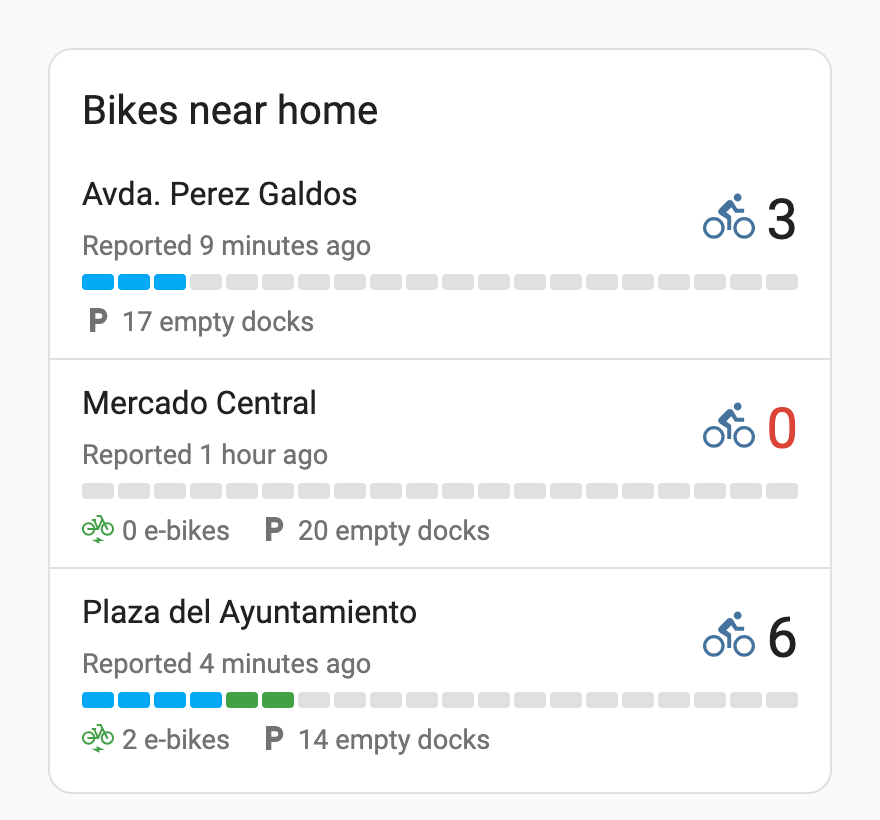

# CityBikes Card

A dashboard card for bike-share stations. For each station it shows the number of
available bikes, a bar of how full the docks are, and the e-bikes and empty docks.



It's made for Home Assistant's built-in
[CityBikes integration](https://www.home-assistant.io/integrations/citybikes/), so
you can keep your YAML setup and only add the card.

Using the [CityBikes custom integration](https://github.com/elcaptain/ha-citybikes)
instead? It comes with its own version of this card, so you don't need this one.

- Bike counts of 2 or fewer show in orange; empty stations show in red.
- The bar has one segment per dock for stations with up to 40 docks, and is
  continuous for bigger stations. Dockless stations show no bar.
- E-bikes show in green, for networks that report them.
- Shows how long ago each station last reported.
- Tap a station to open its details.
- Optional picture of your city's bike instead of the bike icon.
- Optional map of the stations, each marker showing its number of available bikes.
- Follows your theme, light and dark, and the sections layout.

## Installation

### Marketplace (Home Assistant 2026.11 and newer)

1. Go to **Settings > Marketplace**, open the menu in the top right and choose
   **Custom repositories**.
2. Add `https://github.com/elcaptain/ha-citybikes-card` with the type **Dashboard**.
3. Open **CityBikes Card**, download it, and reload the page.

### HACS (Home Assistant 2026.10)

1. In HACS, open the menu in the top right and choose **Custom repositories**.
2. Add `https://github.com/elcaptain/ha-citybikes-card` with the type **Dashboard**.
3. Search for **CityBikes Card**, download it, and reload the page.

### Manual

1. Copy `citybikes-sensor-card.js` into the `www` folder of your Home Assistant
   configuration.
2. Go to **Settings > Dashboards**, open the menu in the top right and choose
   **Resources**. Add `/local/citybikes-sensor-card.js` as a **JavaScript module**.
3. Reload the page.

## Setting up the stations

The stations come from the built-in integration's setup in your
`configuration.yaml`. Each station becomes a sensor:

```yaml
sensor:
  - platform: citybikes
    network: valenbisi  # optional; the closest network is used otherwise
    radius: 300         # stations within this many meters of your home
```

See the [integration documentation](https://www.home-assistant.io/integrations/citybikes/)
for all options. Restart Home Assistant after changing it.

## Adding the card

Edit a dashboard, choose **Add card** and pick **CityBikes**. The visual editor lets
you set a title, a bike image and pick stations. The station list shows each
station's distance from your home, closest first, and the card shows the stations
you pick in that order. Without stations it shows every CityBikes station, sorted
by name.

```yaml
type: custom:citybikes-sensor-card
title: Bikes near home
image: /local/citybike.png   # optional; replaces the bike icon
show_reported: false         # optional; hides "Reported 5 minutes ago"
show_map: true               # optional; map of the stations above the list
entities:                    # optional; station sensors
  - sensor.valenbisi_123
```

| Option          | Description                                                                                                       |
| --------------- | ----------------------------------------------------------------------------------------------------------------- |
| `title`         | Optional card title.                                                                                              |
| `image`         | Optional picture of your network's bike, shown instead of the bike icon.                                          |
| `entities`      | Optional list of station sensors. Leave out to show all stations.                                                 |
| `show_reported` | Show when each station last reported, such as "Reported 5 minutes ago". On by default; set to `false` to hide it. |
| `show_map`      | Show a map of the stations above the list, each marker with its number of available bikes. Off by default.        |

### Using a picture of your city's bike

In the card editor, choose **Upload image** under **Bike image** and pick a picture
of the bike: a PNG, JPEG or GIF of up to 10 MB, ideally a PNG with a transparent
background. **Remove** goes back to the bike icon. Uploading uses Home Assistant's
image upload, which is on by default.

To use an image from elsewhere, enter its address in **Image URL** instead: a link
to an image on the web, or `/local/citybike.png` for a file in the `www` folder of
your Home Assistant configuration.

If the image cannot be loaded, the card shows the bike icon instead.

## Credits

Station data comes from the [CityBikes project](https://citybik.es/#about).
